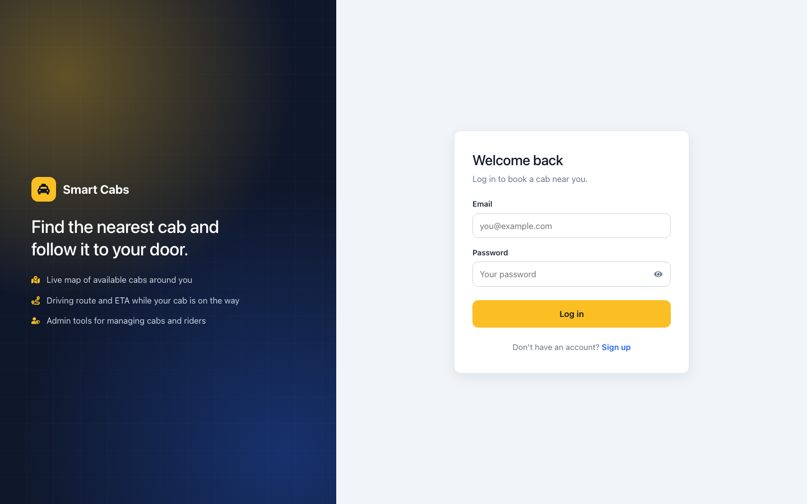
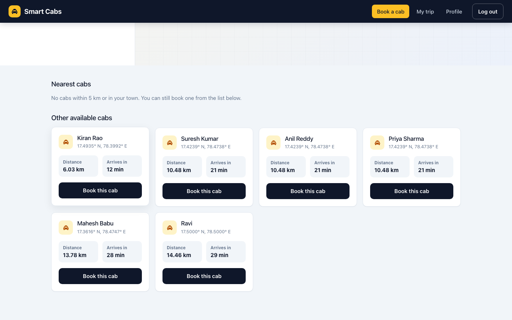
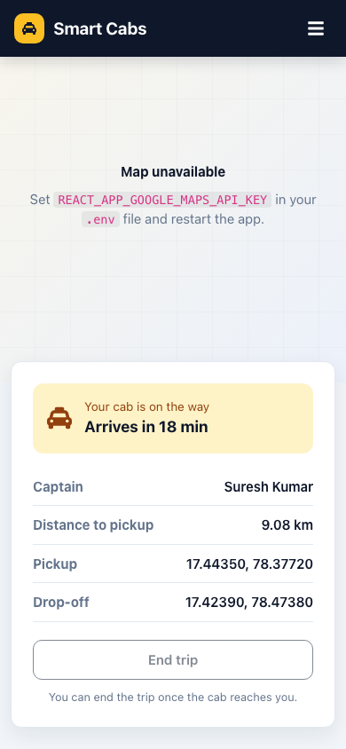
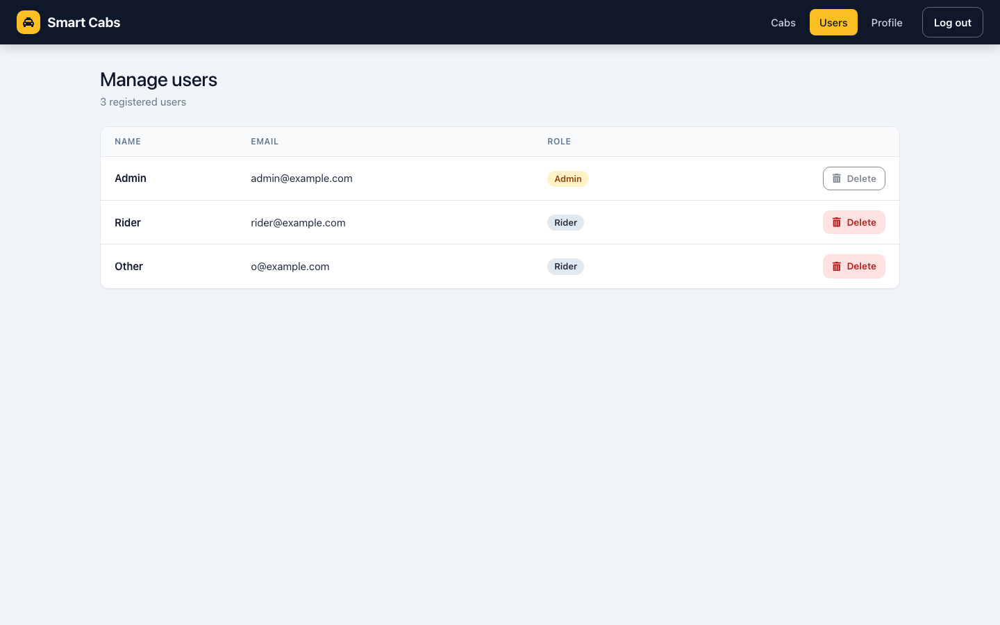

# Smart Cab Allocation

A full-stack cab booking app. Riders find the nearest available cab on Google Maps, book it and follow it along the driving route. Admins manage cabs and users. Built with React, Express, MongoDB and the Google Maps APIs.


[](https://github.com/VamsiKrishnaThota03/smart-cab-allocation/actions/workflows/ci.yml)
[](https://github.com/VamsiKrishnaThota03/smart-cab-allocation/actions/workflows/codeql.yml)
[](LICENSE)

This repository contains the **React frontend at the root** and the **Express API in `backend/`**. The same code is also published as two separate repositories, which is what the live deployment uses:

- Frontend: [smart-cab-allocation-frontend](https://github.com/VamsiKrishnaThota03/smart-cab-allocation-frontend)
- Backend: [smart-cab-allocation-backend](https://github.com/VamsiKrishnaThota03/smart-cab-allocation-backend)

## Live demo

**https://smart-cab-allocation-frontend.vercel.app/login**

Sign up to try it as a rider. Admin accounts are not shared publicly; set `ADMIN_EMAILS` on your own backend to get one.

## Screenshots

| Log in | Cab search results |
| --- | --- |
|  |  |

| Trip on mobile | Manage users (admin) |
| --- | --- |
|  |  |

The screenshots were taken locally with sample data and no Google Maps key, so the map areas show the "Map unavailable" placeholder. With a key set they show the Google map, markers and route.

## Overview

Cabs are stored in MongoDB with coordinates, town, pincode and a booking status. When a rider searches from a pickup location, the frontend works out the distance to every available cab with the Haversine formula and sorts them. It then builds a "nearest cabs" list of cabs that are within 5 km **or** share the rider's town or pincode (reverse geocoding through the backend). Booking a cab marks it unavailable. The trip view draws the Google Directions route from the cab to the rider and animates the cab along it. Ending the trip moves the cab to the drop-off point and makes it available again.

## Features

**Riders**
- Sign up and log in with JWT auth. Expired tokens send you back to the login page.
- A Google Map shows your location (browser Geolocation API) and every available cab as a taxi marker.
- Enter pickup and drop-off coordinates, or click **Pick on map**, then search:
  - every available cab is sorted by straight-line distance (Haversine formula) with an ETA at an average city speed of 30 km/h
  - **Nearest cabs** are those within **5 km** or in the same **town or pincode** as the pickup (reverse geocoding through the backend)
- Book a cab. Booking is atomic on the server, so two riders cannot take the same cab, and each rider has one active booking at a time.
- **My trip**: the driving route from the cab to you (Google Directions API) with the cab animated along it, the remaining distance and ETA. When the cab arrives, **End trip** moves it to your drop-off point and frees it. The page survives a reload, and a booking left over from another session can be released.
- Profile page

**Admins**
- Add a cab (captain name, phone, email, location). Set the location by clicking the map, typing coordinates or using your current position; town and pincode come from reverse geocoding.
- List users and delete non-admin users.
- Admin pages and API routes check the `isAdmin` claim in the signed JWT. Admin rights are given only to emails listed in `ADMIN_EMAILS`.

**UI**
- One colour palette and type scale, visible focus states, labelled form fields
- Responsive layouts with a mobile menu
- Loading, empty and error states instead of `alert()` pop-ups

## Tech stack

| Layer | Tools |
| --- | --- |
| Frontend | React 18 (Create React App), React Router 6, `axios`, `jwt-decode`, `@react-google-maps/api`, `react-icons`, Bootstrap 5 reboot + custom CSS |
| Backend | Node.js, Express 4, Mongoose 8, `jsonwebtoken`, `bcryptjs`, `express-validator`, `axios`, Socket.IO, `dotenv`, `cors` |
| Database | MongoDB |
| External APIs | Google Maps (Maps JavaScript, Directions, Geocoding, Places) |

## Project structure

```
smart-cab-allocation/
├── backend/
│   ├── server.js            # checks config, connects MongoDB, starts HTTP + Socket.IO
│   ├── app.js               # Express app (routes, CORS, error handling)
│   ├── config/              # env helpers, MongoDB connection
│   ├── controllers/         # auth, admin
│   ├── middleware/          # fetchUser (JWT), isAdmin, validate
│   ├── models/              # User, Cab
│   ├── routes/              # auth, cabs, admin, places/geocode
│   └── test/                # node:test smoke tests
├── public/
└── src/
    ├── App.js               # routes
    ├── config.js            # API URL, Maps key, ETA settings
    ├── hooks/               # useGoogleMaps
    ├── utils/               # auth, geo, trip helpers
    └── components/          # Home, MyCab, Login, SignUp, UserDetails,
                             # AdminDashboard, AdminUsers, Navbar, PrivateRoute
```

## Getting started

### Prerequisites

- Node.js 18 or newer and npm
- MongoDB (local or Atlas)
- Optional: Google Maps keys (a browser key for the map and a server key for geocoding)

### Install

```bash
git clone https://github.com/VamsiKrishnaThota03/smart-cab-allocation.git
cd smart-cab-allocation
npm install                     # also installs backend/ dependencies
cp .env.example .env            # frontend settings
cp backend/.env.example backend/.env
```

### Backend environment (`backend/.env`)

| Variable | Required | Description |
| --- | --- | --- |
| `MONGO_URI` | Yes | MongoDB connection string, for example `mongodb://127.0.0.1:27017/smart-cab` |
| `JWT_SECRET` | Yes | Long random string used to sign JWTs |
| `GOOGLE_MAPS_API_KEY` | For geocoding | Server-side key with the Geocoding and Places APIs enabled. Without it the `/api/geocode`, `/api/places` and `/api/place-details` routes return 503 and the "nearest cabs" list falls back to the 5 km radius only |
| `ADMIN_EMAILS` | No | Comma-separated emails that get admin rights when they register |
| `CORS_ORIGIN` | No | Comma-separated allowed browser origins, for example `https://smart-cab-allocation-frontend.vercel.app`. When empty, every origin is allowed (fine for local development) |
| `PORT` | No | API port, default `5001` |
| `HOST` | No | Bind address. Defaults to `127.0.0.1`, or `0.0.0.0` when a managed-platform marker (`RENDER`, `FLY_APP_NAME`, `RAILWAY_ENVIRONMENT`, `DYNO`) is present |
| `RATE_LIMIT_MAX` | No | Requests per IP per 15 minutes across all routes, default `600` |
| `AUTH_RATE_LIMIT_MAX` | No | Login/register attempts per IP+email per 15 minutes, default `20` |
| `PLACES_RATE_LIMIT_MAX` | No | Google Maps proxy calls per IP per minute, default `30` |

The server exits with a clear message if `MONGO_URI` or `JWT_SECRET` is missing.

### Frontend environment (`.env`)

| Variable | Required | Description |
| --- | --- | --- |
| `REACT_APP_API_URL` | No | Backend base URL. Defaults to `http://localhost:5001` in development and `https://smart-cab-allocation-backend.onrender.com` in production builds |
| `REACT_APP_GOOGLE_MAPS_API_KEY` | For maps | Browser key with the Maps JavaScript and Directions APIs enabled. Restrict it by HTTP referrer in the Google Cloud console. Without it the app still works, but the maps show a placeholder and the trip view moves the cab in a straight line |

`REACT_APP_*` values are baked in at build time, so restart `npm start` (or redeploy) after changing them.

### Run

```bash
npm run both        # React dev server on :3000 and the API (nodemon) on :5001
```

Or run them separately:

```bash
npm run server      # API on :5001
npm start           # React dev server on :3000
```

To make yourself an admin, put your email in `ADMIN_EMAILS` before you register.

### Scripts

| Command | Description |
| --- | --- |
| `npm start` | React dev server |
| `npm run build` | Production build into `build/` |
| `npm test` | Frontend tests (Jest + Testing Library) |
| `npm run server` / `npm run server:dev` | API with `node` / `nodemon` |
| `npm run both` | Frontend and API together |
| `npm --prefix backend test` | 15 API tests (no database needed) |
| `npm --prefix backend run test:coverage` | Same, with coverage |

## Hardening and operations

The API listener used to be `server.listen(PORT)`, which binds **every**
interface — so a development server was reachable from anyone on the same
network. It now defaults to `127.0.0.1`, detects managed platforms by their own
environment markers, and honours an explicit `HOST`. A CI job inspects the real
listening socket with `ss -ltn` rather than trusting the code, because the bind
is the kind of thing that regresses quietly.

Added alongside it:

- **helmet** with a deny-all CSP (this is a JSON API; nothing is ever loaded
  from it as a subresource), `nosniff`, and `no-referrer`.
- **Three rate limiters.** A global ceiling; a tighter one on `/api/auth` keyed
  on IP **plus the submitted email**, so one attacker behind a shared address
  cannot lock out everyone else, and which counts successes as well as failures
  so a valid login cannot refill the budget; and a per-minute cap on the Google
  Maps proxy routes, which spend real money per call. `trust proxy` is set to
  exactly one hop, so `X-Forwarded-For` cannot be spoofed to bypass them.
- **Split health probes.** `GET /health` is liveness and never touches Mongo,
  so a database blip cannot trigger a restart loop. `GET /health/ready` reports
  Mongoose's connection state and answers 503 with `Retry-After: 30` until it
  is usable.
- **Graceful shutdown** on SIGTERM/SIGINT that closes Socket.IO then the HTTP
  server, so a deploy does not sever live cab-location streams abruptly.

### Continuous integration

| Job | What it proves |
| --- | --- |
| `backend` (Node 20, 22) | 15 API tests, no database required |
| `bind-address` | Boots the real server and reads `ss -ltn`: no `0.0.0.0:5001` listener by default, a loopback one present, and `HOST=0.0.0.0` still honoured for container hosting |
| `integration` | Against a MongoDB 7 service container: readiness turns green, register/login round-trip over HTTP, the password hash never appears in a response, an anonymous admin call is refused, and `SIGTERM` exits cleanly |
| `frontend` | 5 Jest + Testing Library tests and a production build |
| `docker` | The backend image builds and refuses to start without `JWT_SECRET` |

### Docker

```bash
printf 'MONGO_PASSWORD=%s\nJWT_SECRET=%s\n' \
  "$(openssl rand -hex 16)" "$(openssl rand -hex 32)" > .env

docker compose up --build
```

MongoDB and the API both publish to `127.0.0.1` only, so neither is reachable
from your network, and Compose fails fast with a named error if either variable
is missing.

## API

Protected routes need the JWT in an `auth-token` header. Errors are returned as `{ "message": "..." }`.

| Method | Path | Auth | Purpose |
| --- | --- | --- | --- |
| GET | `/` | - | Health check |
| POST | `/api/auth/register` | - | Register (`name`, `email`, `password`) and return `{ token, isAdmin }` |
| POST | `/api/auth/login` | - | Log in and return `{ token, isAdmin }` |
| GET / POST | `/api/auth/getuser` | User | Current user's profile |
| POST | `/api/cabs/addCab` | Admin | Add a cab (`name`, `phone`, `email`, `latitude`, `longitude`, optional `town`, `pincode`) |
| GET | `/api/cabs/availableCabs` | - | List available cabs (`name`, `latitude`, `longitude`) |
| GET | `/api/cabs/myCab` | User | The cab the current user has booked, or `{ cab: null }` |
| POST | `/api/cabs/bookCab/:cabId` | User | Book an available cab (one active booking per user) |
| POST | `/api/cabs/endTrip/:cabId` | Booking user or admin | End the trip; with `destinationLat` / `destinationLng` the cab moves to the drop-off point |
| GET | `/api/admin/users` | Admin | List users (passwords excluded) |
| DELETE | `/api/admin/users/:id` | Admin | Delete a non-admin user |
| GET | `/api/places?lat=&lng=` | User | Google Places Nearby Search proxy |
| GET | `/api/place-details?placeId=` | User | Google Place Details proxy |
| GET | `/api/geocode?lat=&lng=` | User | Reverse geocode and return `{ postalCode, town }` |

The server also runs a Socket.IO relay that re-broadcasts `cabLocationUpdate` events to every client. The current frontend does not use it; the trip movement is animated in the browser.

## Deployment notes

- **Backend (Render):** set `MONGO_URI`, `JWT_SECRET`, `GOOGLE_MAPS_API_KEY`, `ADMIN_EMAILS` and `CORS_ORIGIN`. The start command is `npm start`.
- **Frontend (Vercel):** set `REACT_APP_GOOGLE_MAPS_API_KEY` and, if the API is not at the default Render URL, `REACT_APP_API_URL`.
- Earlier versions of this repo committed a MongoDB password, a JWT secret and a Google Maps key. They have been removed from the code, but they are still in the git history, so rotate them.

## Known limitations

- The trip is a simulation: the cab marker is animated along the route in the browser, not driven by real GPS updates.
- Locations are entered as `latitude, longitude` text or picked on the map; there is no address search box.
- The "nearest cabs" town/pincode match makes one reverse-geocoding request per cab (cached while the page is open), so it gets slow with many cabs.
- Ending a trip moves the cab straight to the drop-off; the ride from pickup to drop-off is not animated.
- JWTs are kept in `localStorage` and expire after one hour.
- `npm audit` still reports issues inside `react-scripts` (Create React App) that need a breaking upgrade to fix.
- Rate limit counters live in process memory, so every ceiling is per instance. Scaling past one would need a shared store (Redis) for the limits to hold globally.
- `CORS_ORIGIN` unset allows any origin. Acceptable locally, and the API uses a bearer token in `auth-token` rather than cookies, so there is no ambient credential for a hostile page to abuse — but it should be set in production, and must be if cookie auth is ever introduced.
